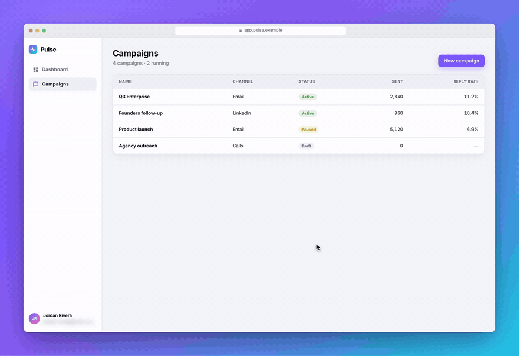
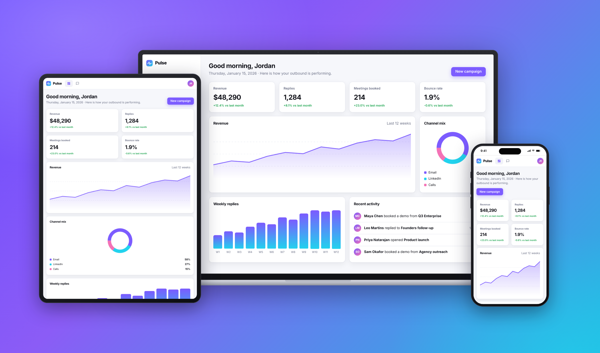
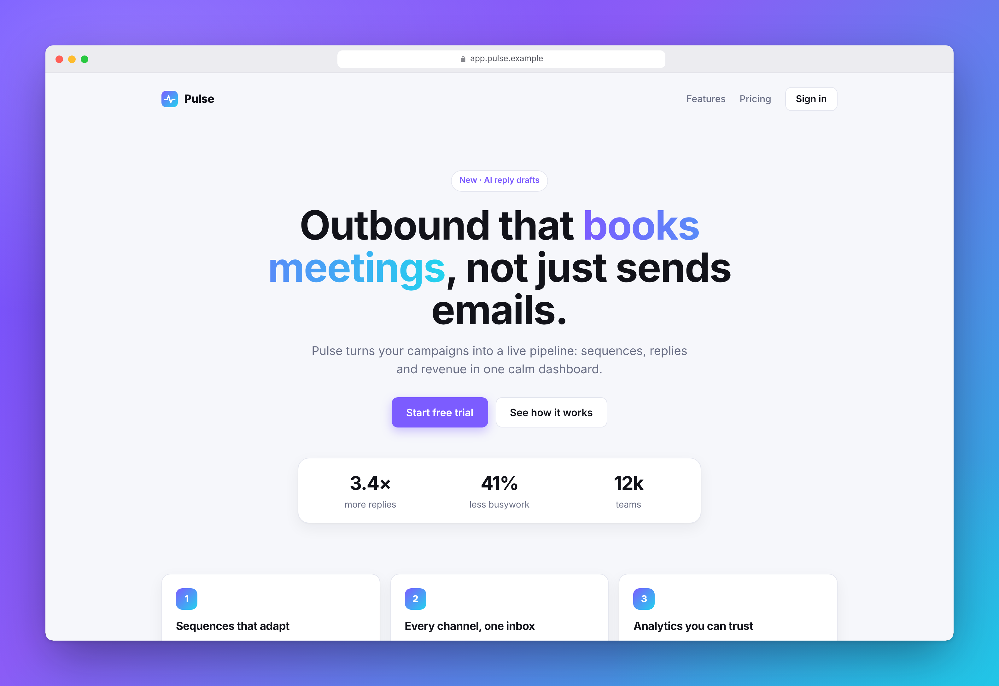
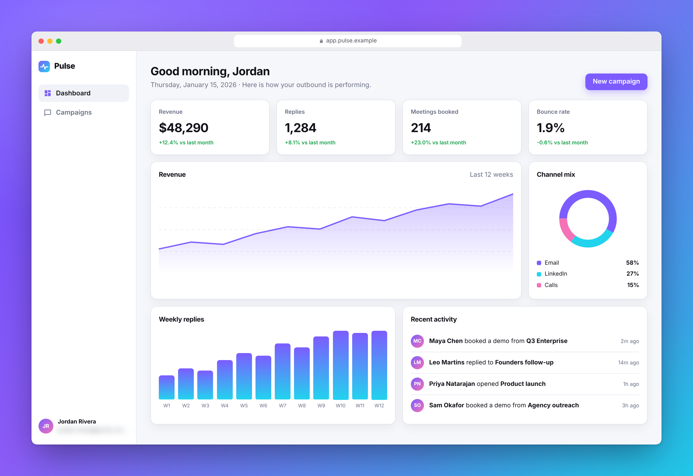
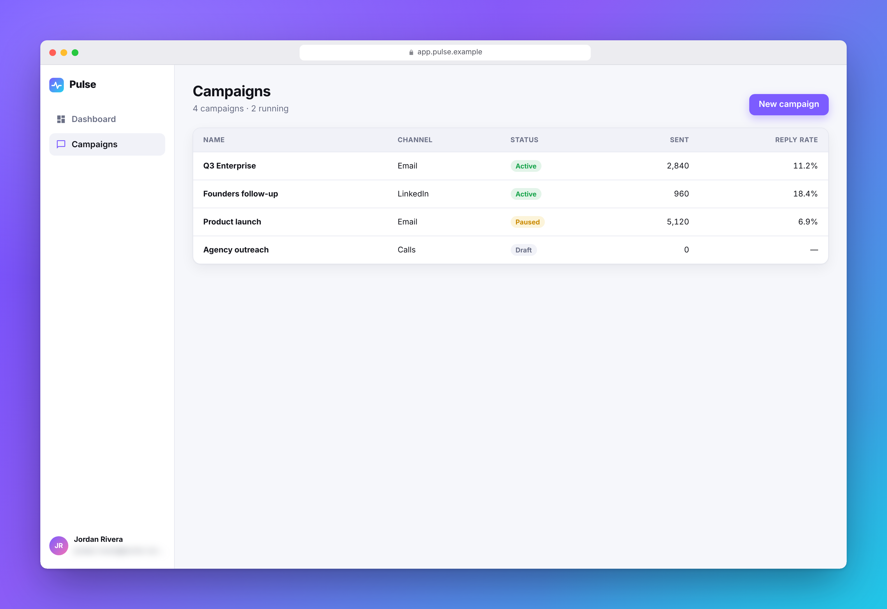

<h1 align="center">reelkit</h1>

<p align="center">
  <b>Turn any deployed web app into a README-ready media kit.</b><br>
  Verified screenshots, device-framed mockups and smooth demo GIFs/MP4s, including pages behind login.<br>
  A Claude Code skill that <i>looks at every frame</i> before it ships.
</p>

<p align="center">
  <a href="https://github.com/jithujsam-cloud/reelkit/actions/workflows/reelkit.yml"></a>
  
  
  
</p>

<!-- reelkit:start -->
<!-- Generated by reelkit. Edit reelkit.config.yaml, then run `reelkit readme --write`. -->
<p align="center">
  <a href="docs/media/new-campaign-framed.mp4"></a>
</p>

<p align="center">
<picture>
  <source media="(prefers-color-scheme: dark)" srcset="docs/media/dashboard-trio-dark.png">
  
</picture>
</p>

<table>
<tr>
<td width="50%" align="center">

<picture>
  <source media="(prefers-color-scheme: dark)" srcset="docs/media/landing-desktop-dark-framed.png">
  
</picture>
<br><sub>Landing page</sub>

</td>
<td width="50%" align="center">

<picture>
  <source media="(prefers-color-scheme: dark)" srcset="docs/media/dashboard-desktop-dark-framed.png">
  
</picture>
<br><sub>Analytics dashboard</sub>

</td>
</tr>
<tr>
<td width="50%" align="center">

<picture>
  <source media="(prefers-color-scheme: dark)" srcset="docs/media/campaigns-desktop-dark-framed.png">
  
</picture>
<br><sub>Campaigns</sub>

</td>
</tr>
</table>
<!-- reelkit:end -->

<p align="center"><sub>Every image and GIF above was generated by reelkit itself from <a href="examples/demo-app">examples/demo-app</a> using <a href="reelkit.config.yaml">this config</a>, and CI regenerates them on every push.</sub></p>

## The problem

Screenshot scripts happily capture pages mid-animation, half-loaded, with skeleton loaders, cookie
banners or blank images, and nobody checks the result. reelkit refuses to ship a frame until it has been:

1. **programmatically proven stable**: network quiet, fonts loaded, images decoded, no skeletons or
   spinners, no running animations, and two consecutive frames pixel-identical; and
2. **visually inspected by Claude** against an 8-point rubric, with the verdict recorded per file.

If a page never settles, the asset is marked **FAILED** with the reason. No file is written, and
nothing half-loaded ends up in your README.

## 30-second quickstart

```text
/plugin install reelkit --marketplace jithujsam-cloud/reelkit
```
Then, in any project:
```text
> Make README screenshots and a demo GIF of https://my-app.com. The dashboard needs login.
```
Claude discovers your routes, drafts `reelkit.config.yaml` for your approval, asks you to sign in once
in a real browser window, captures everything, reviews every frame, and writes the README block.

## Install

**Claude Code plugin (recommended)**
```text
/plugin install reelkit --marketplace jithujsam-cloud/reelkit
```
On older Claude Code versions: `/plugin marketplace add jithujsam-cloud/reelkit`, then `/plugin install reelkit@reelkit`.

**Manual skill install**
```bash
git clone https://github.com/jithujsam-cloud/reelkit
cp -r reelkit/skills/reelkit ~/.claude/skills/reelkit      # Windows: copy to %USERPROFILE%\.claude\skills\reelkit
```

**Requirements:** Node 18.17+. Everything else is handled for you: dependencies install into the skill
folder on first run, Playwright Chromium installs automatically, and gifski ships bundled. Install
**ffmpeg** for GIF/MP4 (`brew install ffmpeg` · `sudo apt install ffmpeg` · `winget install Gyan.FFmpeg`).

**Without Claude** (CI, scripts): the CLI works on its own.
```bash
node ~/.claude/skills/reelkit/scripts/reelkit.mjs init --url https://my-app.com
node ~/.claude/skills/reelkit/scripts/reelkit.mjs all
```

## What you get

| output | file | notes |
|---|---|---|
| Stills | `{scene}-{viewport}-{theme}.png` | 2× density, light + dark, optional full page |
| Framed mockups | `…-framed.png` | browser, phone (with status bar), tablet, laptop; gradient/mesh/solid/transparent backgrounds |
| Responsive trio | `{scene}-trio-{theme}.png` | laptop + tablet + phone, overlapping |
| Demo video | `{flow}.mp4`, `.webm`, `.gif` | synthetic cursor, click ripples, human typing, zoom toward clicks, dead time trimmed, seamless loop |
| Framed video | `{flow}-framed.mp4/.gif` | the recording composited into the same device frames |
| Social preview | `social-preview.png` | exactly 1280×640 for GitHub → Settings → Social preview |
| README block | between `<!-- reelkit:start -->` / `<!-- reelkit:end -->` | `<picture>` light/dark variants; never touches the rest of your README |
| QA | `.reelkit/qa-report.json`, `.reelkit/contact-sheet.png`, `docs/media/manifest.json` | every asset's checks, retries and visual verdict |

## How it works

```
discover routes → draft config (you approve) → auth once → shoot · record · frame → verify → Claude reviews → README
```

**Stability engine.** Before any still: no in-flight requests for 500 ms · `document.fonts.ready` · lazy
content scrolled into view and back · every `` decoded · no skeletons/spinners (`aria-busy`,
skeleton/shimmer/spinner classes, your selectors) · `document.getAnimations()` idle · two screenshots
400 ms apart pixel-identical, twice in a row. Up to 3 attempts with escalating waits, then FAILED.

**Determinism.** Frozen clock (dates never drift between runs, so re-runs are byte-identical), fixed
locale/timezone, reduced motion for stills, caret and scrollbars hidden, and a built-in hide list for
consent banners, chat widgets, toasts and dev overlays. `mask:` blurs PII.

**Visual QA gate.** `reelkit verify` extracts frames from every video (first, middle, end state, and before/after
each click) and lists every file. Claude opens each one, checks the [rubric](skills/reelkit/reference/qa-rubric.md),
and records `pass`/`fail` with a note. Verdicts are pinned to the file's SHA-256, so a re-captured file
needs a fresh look. `verify --strict` fails until everything passes.

**Motion.** CDP screencast at true 2× scale. Frames only arrive when pixels change, so capping each
frame's hold trims dead time. The cursor is injected into the page; zoom runs in post on full-res frames.
GIFs go through a byte-budget ladder (width → fps → quality) until they fit (default 5 MB).

## Config

```yaml
name: Pulse
baseUrl: https://app.example.com
defaults: { viewports: [desktop, mobile], theme: both, outputs: [still, framed], mask: [".user-email"] }
auth: { mode: manual, loginUrl: /login }
scenes:
  - name: dashboard
    url: /dashboard
    auth: true
    viewports: [desktop, tablet, mobile]
    waitFor: { text: "Recent activity" }
  - name: new-campaign                 # a recorded flow
    url: /campaigns
    auth: true
    zoom: 1.35
    outputs: [mp4, gif, framed]
    actions:
      - click: "text=New campaign"
      - type: { into: "#campaign-name", text: "Q4 Outbound" }
      - select: { from: "#channel", value: "LinkedIn" }
      - click: { selector: "text=Create campaign", zoom: false }
marketing: { hero: new-campaign, trio: dashboard, social: { scene: dashboard } }
```

Full reference: [config](skills/reelkit/reference/config.md) · [auth](skills/reelkit/reference/auth.md) ·
[stability](skills/reelkit/reference/stability.md) · [motion](skills/reelkit/reference/motion.md) ·
[framing](skills/reelkit/reference/framing.md) · [JSON Schema](skills/reelkit/schema/reelkit.schema.json) ·
[annotated example](skills/reelkit/reelkit.config.example.yaml).

**Commands:** `preflight` · `discover` · `init` · `auth` · `shoot` · `record` · `frame` · `verify` · `readme` · `all`,
with `--only <scene>` for fast iteration and `--ci` for pipelines.

## reelkit vs. the alternatives

| | manual screenshots | generic screenshot CLIs | **reelkit** |
|---|:-:|:-:|:-:|
| Pages behind login (OAuth, 2FA) | ✅ (by hand) | ⚠️ scripted only | ✅ manual, form or token modes |
| Waits for animations, skeletons, lazy images | 👀 you hope | ⚠️ fixed delay / network idle | ✅ 7-gate stability engine + retries |
| Refuses to ship a bad frame | ❌ | ❌ | ✅ FAILED with the reason |
| Someone actually looks at the output | sometimes | ❌ | ✅ Claude reviews every asset, verdict on record |
| Cookie banners, chat widgets, PII | manual cleanup | ❌ | ✅ hidden / blurred automatically |
| Reproducible re-runs | ❌ | ⚠️ | ✅ frozen clock, byte-identical stills |
| Device frames, trio, social preview | design tool | ❌ | ✅ light + dark |
| Demo GIF/MP4 with cursor, zoom, trimmed dead time | screen recorder + editor | ❌ | ✅ under a size budget |
| README update | copy/paste | ❌ | ✅ between markers only |
| Runs in CI | ❌ | ✅ | ✅ |

## FAQ

**How does login work? Will Claude see my password?**
No. By default you run `reelkit auth` yourself and sign in in a real browser window. The session is saved
to `.reelkit/auth.json` (git-ignored, 0600) and Claude never types a password. For CI, use env vars
(`REELKIT_EMAIL`/`REELKIT_PASSWORD` in `.env` or CI secrets) with `auth.mode: form`. See [auth.md](skills/reelkit/reference/auth.md).

**My app uses Google/GitHub OAuth, magic links or 2FA.**
Use the default manual mode: you complete the provider flow in the window that opens. reelkit saves the
session once you land back in the app. Expired sessions are detected (redirect to login, 401/403, visible
login form), and reelkit stops with exit code 3 instead of photographing a login page.

**My preview deployments are behind Vercel Deployment Protection.**
Add `headers: { x-vercel-protection-bypass: ${VERCEL_AUTOMATION_BYPASS_SECRET} }` to the config. For
preview-only login routes, use `auth.mode: token`.

**My GIF is too big.**
reelkit already steps width, fps and quality down until the GIF fits `gif.maxBytes` (5 MB). If it still
doesn't fit, it fails loudly. Shorten the flow, lower `gif.width`, or embed the MP4 (the README block
links the GIF to it).

**A scene keeps FAILING.**
The reason names the gate: `animations` (an infinite decorative loop: `hide` it or `allowInfinite`), `busy`
(a skeleton that never resolves: check the data loads), `network` (polling: `ignoreRequests`),
`pixels` (carousel/ticker). See [troubleshooting](skills/reelkit/reference/troubleshooting.md).

**Does it phone home?**
No telemetry. The only network traffic goes to your site and to package registries during install.

**Windows / macOS / Linux?**
All three. It's plain Node ESM with no build step and no bash-only scripts, and CI runs the test suite on all three.

**Can I rename it?**
Change `NAME` in [`scripts/lib/brand.mjs`](skills/reelkit/scripts/lib/brand.mjs): CLI name, work dir, env prefix
and README markers all follow it.

**Licensing of bundled tools?**
reelkit is MIT. gifski (AGPL-3.0) is an optional npm dependency that reelkit runs as a separate binary.
Remove it and ffmpeg's palette encoder is used instead.

## Contributing

See [CONTRIBUTING.md](CONTRIBUTING.md). The demo app has `?chaos=1` and `?chaos=forever` switches that
break stability on purpose, and CI proves the engine waits for the first and refuses the second.

## License

[MIT](LICENSE)
